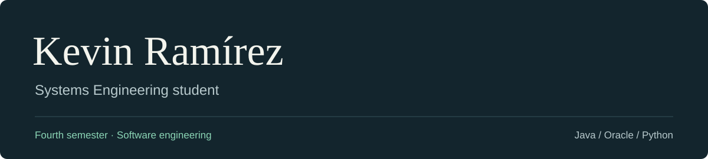

  

## About me

I'm Kevin Ramírez, a **fourth-semester Systems Engineering student**.

I'm particularly interested in **software engineering**. I enjoy learning how to plan an application, organize its code, and turn an idea into something that works.

My university work involves **Java, Oracle, and Python**. I'm continuing to develop my programming skills as I work through my degree.

## Languages & tools

  &nbsp;&nbsp;&nbsp;&nbsp;
  &nbsp;&nbsp;&nbsp;&nbsp;
  

**Java** &nbsp; · &nbsp; **Oracle** &nbsp; · &nbsp; **Python**
